# Ultimo-Mobile

[](https://github.com/StanislawGolec/Ultimo-Mobile/actions/workflows/android-release.yml)
[-green.svg)](https://developer.android.com/)
[](https://kotlinlang.org/)
[](https://developer.android.com/jetpack/compose)
[](https://developer.android.com/topic/architecture)
[](LICENSE)

Native Android client for the Ultimo authoritative multiplayer card game platform. Built with Kotlin 2.0 (K2 compiler), Jetpack Compose Material 3, Unidirectional Data Flow (MVI), low-latency WebSockets (RFC 6455), Room Database, hardware-accelerated Canvas animations, and adaptive layout orchestration across phones, foldables, and tablets.

---

## Direct APK Installation

Scan the QR code below on your Android device to download and install the latest signed release APK:

<div align="center">
  
  <br/>
  <a href="https://github.com/StanislawGolec/Ultimo-Mobile/releases/latest/download/app-release.apk"><b>Download Latest app-release.apk</b></a>
</div>

---

## Architecture Overview

Ultimo-Mobile implements Clean Architecture with Unidirectional Data Flow (MVI). The user interface is 100% declarative with zero XML layouts.

```mermaid
flowchart TD
    subgraph UI ["Presentation Layer (Jetpack Compose Material 3)"]
        TableScreen["GameTableScreen / GameRoute"]
        LobbyScreen["LobbyScreen"]
        CardCanvas["CardView (Canvas Vector)"]
        HandCarousel["HandCarousel (Drag Physics)"]
        Opponents["OpponentBar (16 Players)"]
        DefenseHUD["DefenseHudBanner (Defend & Stack)"]
        Podium["PodiumDialog (Tournament Standings)"]
    end

    subgraph MVI ["MVI State Machine"]
        GameVM["GameViewModel"]
        LobbyVM["LobbyViewModel"]
        UiState["StateFlow&lt;GameUiState&gt;"]
        UiEffect["SharedFlow&lt;GameUiEffect&gt;"]
    end

    subgraph Domain ["Domain Layer (UseCases)"]
        PlayCard["PlayCardUseCase"]
        DrawCard["DrawCardUseCase"]
        DeclareUltimo["DeclareUltimoUseCase"]
        ConnectGame["ConnectToGameUseCase"]
        RecordOutcome["RecordMatchOutcomeUseCase"]
    end

    subgraph Core ["Data & Network Layer"]
        WSEngine["OkHttpWebSocketEngine"]
        NetObserver["NetworkConnectivityObserver"]
        RoomDB["UltimoDatabase (Room)"]
        Prefs["UserPreferencesRepository (DataStore)"]
        Audio["SoundEffectsManager (SoundPool)"]
        Haptics["HapticFeedbackManager"]
    end

    TableScreen --> |"GameUiIntent"| GameVM
    LobbyScreen --> |"LobbyUiIntent"| LobbyVM
    GameVM --> |"Immutable State"| UiState --> TableScreen
    GameVM --> |"One-off Events"| UiEffect --> Audio
    GameVM --> |"One-off Events"| UiEffect --> Haptics
    GameVM --> PlayCard & DrawCard & DeclareUltimo & RecordOutcome
    PlayCard & DrawCard & DeclareUltimo --> WSEngine
    RecordOutcome --> RoomDB
    ConnectGame --> WSEngine & Prefs
    NetObserver --> WSEngine
```



---

## Key Features & Engineering Capabilities

### 1. Custom Vector Canvas Card Rendering
- Hardware-accelerated vector rendering via Jetpack Compose `Canvas` with zero raster images.
- Tilted oval centerpiece rotated at -28 degrees, inverted 180-degree corner indices, and custom vector geometry:
  - `SKIP`: circle-slash glyph.
  - `REVERSE`: dual curved recycling arrows with filled arrowheads.
  - `DRAW_TWO`: offset overlapping card frames with "+2" badge.
  - `WILD` & `WILD_DRAW_FOUR`: four-quadrant colored circular dial with center badge.
  - Number cards (0 to 9): bold centered digits with drop shadow and underline for 6 and 9.
  - Card back: textured dark felt pattern with tilted "ULTIMO" typography.

### 2. 60/120 FPS Drag Physics & Layout Phase Deferral
- Real-time gesture tracking via `Modifier.pointerInput` with `detectDragGestures` and `detectTapGestures`.
- High-frequency drag coordinates are strictly deferred to Layout (`Modifier.offset { IntOffset(...) }`) and Draw (`Modifier.graphicsLayer { ... }`) phases, ensuring zero recomposition during continuous touch movement.
- Mathematical fan-shaped hand carousel:
  $$\theta_i = (i - \frac{N-1}{2}) \cdot \Delta \theta, \quad y_i = |i - \frac{N-1}{2}|^2 \cdot \Delta y$$
- Dynamic horizontal card spacing compression scaling smoothly from 1 to 15+ cards.
- Fling drop detection into discard pile target zone, with physics spring-back recovery on cancelled or illegal moves.

### 3. Scalable 16-Player Opponents Carousel
- Scalable opponent rendering supporting up to 15 opponents ($1 + 15$ match capacity).
- Adaptive chip view:
  - Expanded player cards for matches with $\le 3$ opponents.
  - Compact pill chips with avatar icon, card count badge, and animated active turn halo for $4$ to $15$ opponents.
- Automatic horizontal scroll centering on the active turn player.
- Visual badges for disconnected opponents with countdown grace period indicators.

### 4. Multi-Deck Draw Pile Visualizer (Up to 216 Cards)
- Center table visualizer dynamically adjusts stack depth based on remaining draw pile count:
  - $\le 30$ cards: single-layer card.
  - $31$ to $108$ cards: 3-layer offset stack.
  - $109$ to $216$ cards (multi-deck): 5-layer deep deck stack with gold border accent.
- Dynamic numerical badge displaying exact remaining cards atop the pile.

### 5. Room Discovery, Secret Access Codes & Host Controls
- Public room browsing via `LIST_ROOMS` / `ROOM_LIST` protocol in `RoomBrowserDialog`.
- Private room creation with 4-letter alphanumeric access codes in `CreateRoomDialog` and `AccessCodeDialog`.
- In-game host authority:
  - Gold crown avatar indicator for room owner.
  - Host action menu: kick player (`KICK`), transfer host role (`TRANSFER_OWNERSHIP`), and start match (`START`).
  - Automatic host reassignment when the previous room owner disconnects.

### 6. Tactical Action Defending & Penalty Stacking
- **Skip Deflection:** Players can defend against incoming `SKIP` cards by playing another `SKIP`, deflecting the block to the subsequent player. Displayed via pulsing blue shield banner (`DefenseHudBanner`).
- **Penalty Stacking:** Accumulating `DRAW_TWO` (+2) and `WILD_DRAW_FOUR` (+4) penalties (stacking up to +8 or more). Discard pile renders stacked penalty badge.
- **Draw Auto-Pass:** If a drawn card cannot be played, turn transitions automatically with a non-blocking toast notification.

### 7. Last-Man-Standing Podium & ULTIMO Shouting
- Match continues until only 1 player remains holding cards (1st, 2nd, 3rd, and last place).
- Finished players automatically enter Spectator Mode, observing live game action until final match resolution.
- 3D stepped podium dialog (`PodiumDialog`) displaying complete standings upon match conclusion.
- "SHOUT ULTIMO!" button enabled when hand reaches $\le 2$ cards.
- "CATCH ULTIMO!" badge on opponents holding 1 card without shouting Ultimo, triggering a 6-card penalty draw.

### 8. Resilient WebSocket State Machine (120s Grace Period)
- Persistent RFC 6455 duplex communication via `OkHttpWebSocketEngine`.
- Full-jitter exponential backoff reconnection algorithm:
  $$\Delta t_k = \min(30\text{s}, 1\text{s} \cdot 2^{k-1}) \pm 20\%$$
- Fast-track instant reconnection on network capability recovery via `ConnectivityManager.NetworkCallback`.
- 15-second heartbeat keep-alive watchdog detecting dead sockets.
- 120-second session grace period: players reconnecting within 2 minutes automatically rejoin their active seat and receive an authoritative state recovery snapshot.

### 9. Adaptive Multiplatform Layouts (WindowSizeClass)
- Responsive layout architecture supporting phones, foldables, and tablets via `WindowWidthSizeClass`:
  - **Compact (<600dp):** Optimized vertical layout for standard phones in portrait.
  - **Medium (600dp..840dp):** Expanded horizontal card fan with wider table area for foldables and small tablets.
  - **Expanded (>840dp):** Dual-column layout for Pixel Tablet, desktop DeX, and landscape displays.
- Safe drawing insets handling camera punch-holes and system navigation bars edge-to-edge.

### 10. Low-Latency Audio & Tactile Haptics
- Instantaneous game audio via Android `SoundPool` with `AudioAttributes.USAGE_GAME`.
- Runtime algorithmic synthesis of uncompressed 16-bit mono 44.1kHz PCM WAV clips (card snap, swoosh, chime, brass chord, fanfare, warning buzzer).
- Amplitude-modulated tactile feedback via Android `VibrationEffect` waveforms (`LIGHT_TICK`, `MEDIUM_SNAP`, `HEAVY_WARNING`).

### 11. Local Offline Persistence
- SQLite persistence via Room Database:
  - `PlayerProfileEntity`: Lifetime games, victories, defeats, and win streak tracking.
  - `MatchRecordEntity`: Detailed match outcome history with duration, scores, and opponent lists.
  - `CardStatEntity`: Frequency tracking for played and drawn cards.
- Jetpack DataStore Preferences for reactive server endpoint selection, player handle memory, and audio/haptic toggles.

---

## Automated Testing & Chaos Engineering

The repository includes comprehensive automated test coverage across unit, coroutine flow, UI semantics, and network chaos layers:

1. **Jetpack Compose UI Semantics (`GameTableScreenTest.kt`, `OpponentBarSemanticsTest.kt`, `PodiumDialogTest.kt`):**
   - Headless Robolectric and Compose Test verification using `createComposeRule()`.
   - Tests room header copying, "SHOUT ULTIMO!" button enablement transitions, tactical defense banners, podium standings, and responsive window size layouts.
2. **Turbine Coroutine Flow Verification (`GameViewModelTest.kt`, `DefenseMechanicsTest.kt`):**
   - Validates deterministic MVI state transitions using CashApp Turbine and `StandardTestDispatcher`.
   - Verifies handling of `ROOM_LIST`, `ROOM_OWNER_CHANGED`, `PLAYER_FINISHED`, `MATCH_STANDINGS`, and `ULTIMO_PENALTY`.
3. **Network Chaos Resilience (`ChaosResilienceTest.kt`):**
   - Simulates 20% packet drops, 150ms Gaussian jitter, and abrupt TCP socket severance against `ProtocolCodec` and `OkHttpWebSocketEngine`.
   - Validates exponential backoff delay bounds, state re-handshake, and zero unhandled runtime crashes under adverse network conditions.

---

## Tech Stack & Dependency Matrix

| Layer | Technology | Version | Purpose |
| :--- | :--- | :--- | :--- |
| **Language** | Kotlin (K2 Compiler) | `2.0.21` | Modern idiomatic Kotlin, sealed hierarchies, null safety |
| **UI Framework** | Jetpack Compose Material 3 | BOM `2024.10.01` | Declarative UI, Material 3 theming, animations |
| **Networking** | OkHttp WebSocket | `4.12.0` | RFC 6455 persistent duplex communication |
| **Concurrency** | Kotlin Coroutines & Flow | `1.9.0` | Reactive asynchronous streams (`StateFlow`, `SharedFlow`) |
| **Dependency Injection** | Dagger Hilt | `2.52` | Compile-time dependency injection |
| **Local Database** | Room Database | `2.6.1` | Type-safe SQLite persistence |
| **Preferences** | DataStore Preferences | `1.1.1` | Reactive asynchronous settings storage |
| **Audio** | Android SoundPool | Android API | Low-latency audio sonification |
| **Haptics** | Android VibrationEffect | Android API | Amplitude-modulated tactile feedback |
| **Navigation** | Navigation Compose | `2.8.3` | Type-safe declarative Compose navigation |
| **Testing** | CashApp Turbine | `1.2.0` | Reactive StateFlow stream validation |
| **Testing** | Truth | `1.4.4` | Fluent assertion framework |
| **Testing** | MockK | `1.13.13` | Kotlin mocking library |
| **Testing** | Compose UI Test JUnit4 | `1.7.5` | Compose Semantics accessibility testing |
| **CI/CD** | GitHub Actions | Workflows | Automated testing, keystore signing, release publishing |

---

## Getting Started

### Prerequisites
- Android Studio Ladybug (2024.2.1) or newer
- JDK 21 (Eclipse Temurin recommended)
- Android SDK 35 (API 26 minimum)

### Building & Running Locally
```bash
# Clone the repository
git clone https://github.com/StanislawGolec/Ultimo-Mobile.git
cd Ultimo-Mobile/ultimo-mobile

# Build debug APK
./gradlew assembleDebug

# Run unit and coroutine test suites
./gradlew testDebugUnitTest
```

### Server Endpoint Configuration
The client features a built-in server switcher accessible directly from the Lobby:
- **Production Server:** `wss://ultimo-server-xyz.a.run.app/ws`
- **Local Server:** `ws://10.0.2.2:8080/ws`
- **Go-Chaos-Proxy:** `ws://10.0.2.2:9090/ws` (Simulates packet drop, jitter, and socket severance)

---

## License

This project is licensed under the MIT License - see the [LICENSE](LICENSE) file for details.

---

## Development

Developed with the assistance of agentic AI workflows and LLMs.
