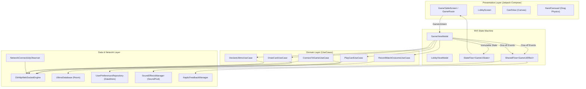

# Ultimo-Mobile

[](https://github.com/StanislawGolec/Ultimo-Mobile/actions/workflows/android-release.yml)
[-green.svg)](https://developer.android.com/)
[](https://kotlinlang.org/)
[](https://developer.android.com/jetpack/compose)
[](https://developer.android.com/topic/architecture)
[](LICENSE)

Native Android client for the Ultimo authoritative multiplayer card game platform. Built with Kotlin 2.0, Jetpack Compose Material 3, Unidirectional Data Flow (MVI), low-latency WebSockets (RFC 6455), Room Database, and hardware-accelerated Canvas animations.

---

## Direct APK Installation

Scan the QR code below on your Android device to download and install the latest signed release APK:

<div align="center">
  
  <br/>
  <a href="https://github.com/StanislawGolec/Ultimo-Mobile/releases/latest/download/app-release.apk"><b>Download Latest app-release.apk</b></a>
</div>

---

## Architecture Overview

Ultimo-Mobile implements Clean Architecture with Unidirectional Data Flow (MVI). The user interface is 100% declarative with zero legacy XML layouts.



---

## Engineering Highlights

### 1. Custom Vector Canvas Card Rendering
- Hardware-accelerated vector drawing using Jetpack Compose `Canvas` with zero rasterized assets.
- Tilted oval centerpiece rotated at -28 degrees, inverted 180-degree corner indices, and custom vector glyphs (`SKIP`, `REVERSE` curved recycling arrows, `DRAW_TWO` overlapping offset frames, and `WILD` 4-quadrant circular dial).
- Scales dynamically to any screen resolution and density without pixelation.

### 2. 60/120 FPS Drag Physics & Layout Phase Deferral
- Real-time gesture tracking via `Modifier.pointerInput` with `detectDragGestures`.
- High-frequency drag coordinates are strictly deferred to Layout (`Modifier.offset { IntOffset(...) }`) and Draw (`Modifier.graphicsLayer { ... }`) phases, avoiding recomposition during continuous touch movement.
- Mathematical fan-shaped hand carousel:
  $$\theta_i = (i - \frac{N-1}{2}) \cdot \Delta \theta, \quad y_i = |i - \frac{N-1}{2}|^2 \cdot \Delta y$$
- Dynamic card spacing compression as hand size scales from 1 to 15+ cards.
- Fling drop detection into discard pile target zone, and physics spring-back recovery on cancelled or illegal plays.

### 3. Resilient WebSocket State Machine
- Persistent RFC 6455 duplex streaming via `OkHttpWebSocketEngine`.
- Full-jitter exponential backoff reconnection algorithm:
  $$b_n = \min(M, B \cdot f^n) \pm \text{jitter}$$
- Live countdown ticker notifying users of remaining seconds until next retry.
- Fast-track instant reconnection on Android network capability restoration.
- 15-second heartbeat keep-alive watchdog with automatic socket recovery.

### 4. Low-Latency Audio & Tactile Haptics
- Instantaneous game sound playback using Android `SoundPool` with `AudioAttributes.USAGE_GAME`.
- Dynamic runtime synthesis of uncompressed 16-bit mono 44.1kHz PCM WAV clips (card snap, swoosh, chime, brass chord, fanfare, warning buzzer).
- Amplitude-modulated tactile feedback via Android `VibrationEffect` waveforms (`LIGHT_TICK`, `MEDIUM_SNAP`, `HEAVY_WARNING`).

### 5. Local Offline Persistence
- SQLite caching using Room Database:
  - `PlayerProfileEntity`: Lifetime games, victories, and current winning streak.
  - `MatchRecordEntity`: Detailed match logs with duration, cards played, and opponents.
  - `CardStatEntity`: Frequency analysis of drawn and played cards.
- Jetpack DataStore Preferences for reactive server endpoint selection and audio/haptic toggles.

---

## Tech Stack & Library Matrix

| Layer | Technology | Version | Purpose |
| :--- | :--- | :--- | :--- |
| **Language** | Kotlin (K2) | `2.0.21` | Modern idiomatic language with sealed hierarchies |
| **UI** | Jetpack Compose | BOM `2024.10.01` | Declarative UI, Material 3, animations |
| **Networking** | OkHttp WebSocket | `4.12.0` | RFC 6455 persistent duplex communication |
| **Concurrency** | Kotlin Coroutines | `1.9.0` | Asynchronous streams (`StateFlow`, `SharedFlow`) |
| **Dependency Injection** | Dagger Hilt | `2.52` | Compile-time dependency injection |
| **Local Database** | Room Database | `2.6.1` | Type-safe SQLite persistence |
| **Preferences** | DataStore Preferences | `1.1.1` | Reactive asynchronous preferences |
| **Audio** | Android SoundPool | Android API | Low-latency audio sonification |
| **Testing** | CashApp Turbine | `1.2.0` | Reactive StateFlow stream validation |
| **Testing** | MockK | `1.13.13` | Kotlin mocking library |
| **Testing** | Compose UI Test | `1.7.5` | Compose Semantics accessibility testing |
| **CI/CD** | GitHub Actions | Workflows | Automated testing, keystore signing, release publishing |

---

## Getting Started

### Prerequisites
- Android Studio Ladybug or newer
- JDK 21 (Temurin recommended)
- Android SDK 35 (API 26 minimum)

### Building & Running Locally
```bash
# Clone the repository
git clone https://github.com/StanislawGolec/Ultimo-Mobile.git
cd Ultimo-Mobile/Ultimo-Mobile

# Build debug APK
./gradlew assembleDebug

# Run unit and coroutine test suites
./gradlew testDebugUnitTest
```

### Server Endpoint Configuration
The client features a built-in server switcher accessible directly from the Lobby:
- **Production Server:** `wss://ultimo-server-xyz.a.run.app/ws`
- **Local Emulator:** `ws://10.0.2.2:8080/ws`
- **Go-Chaos-Proxy:** `ws://10.0.2.2:9090/ws` (Simulates packet drop and network jitter)

---

## License

This project is licensed under the MIT License - see the [LICENSE](LICENSE) file for details.
